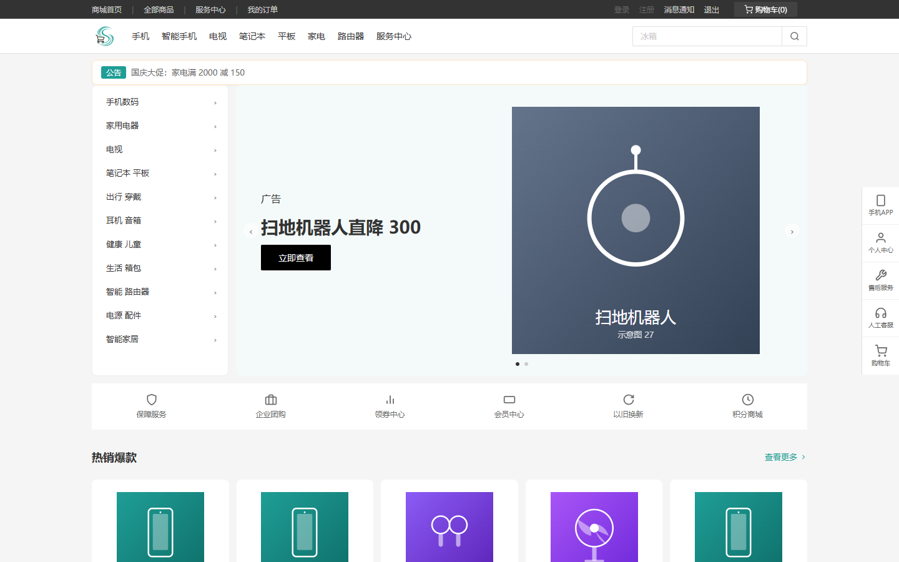
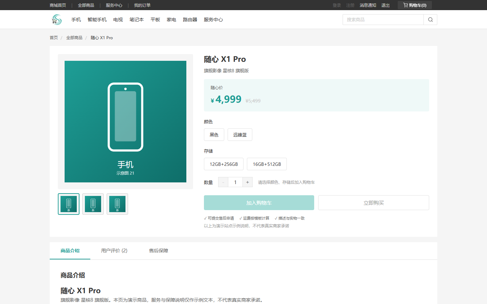
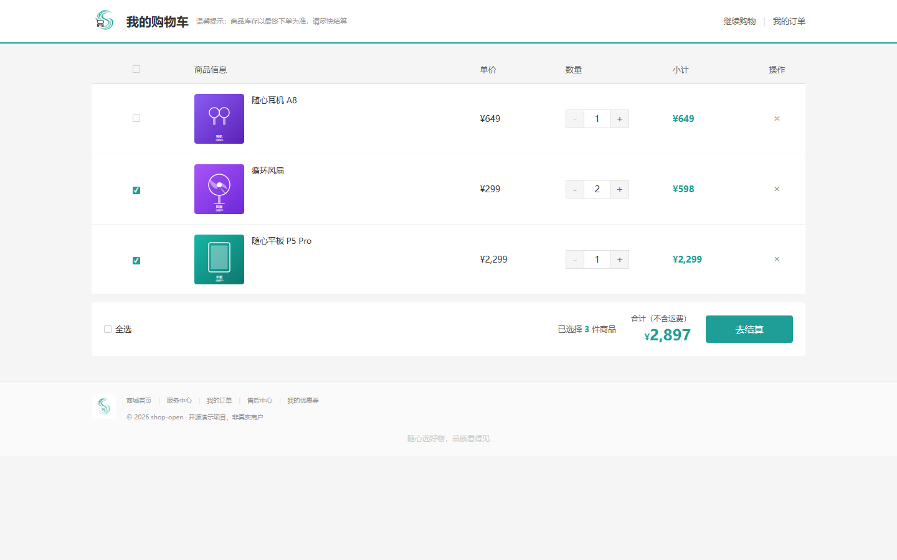
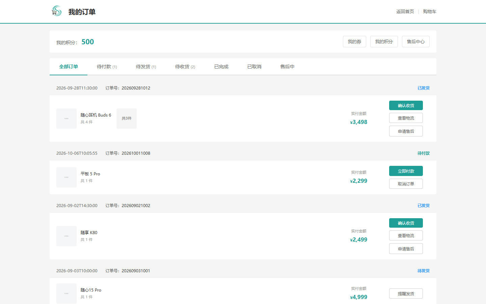
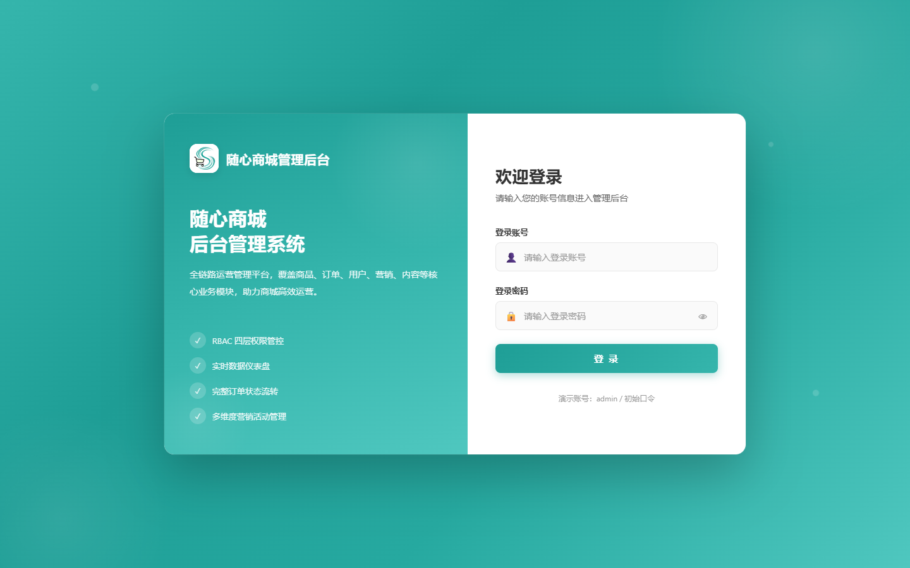
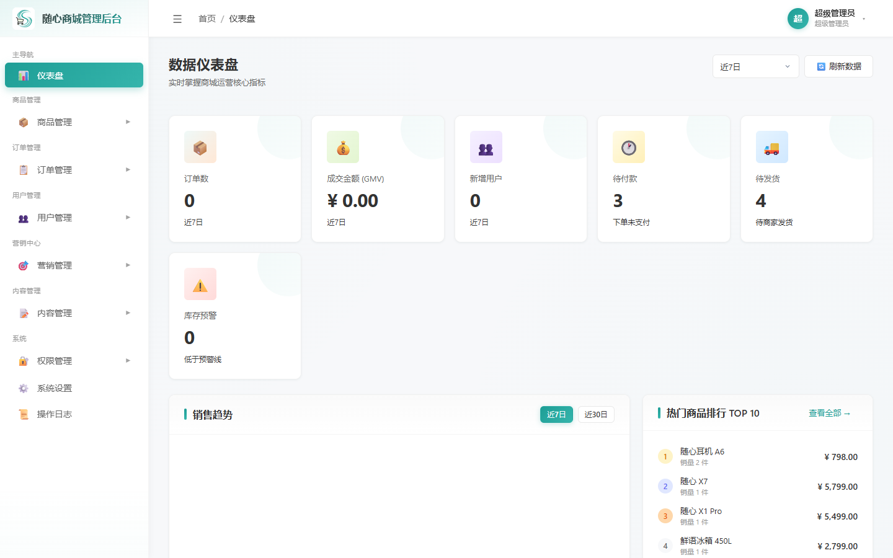
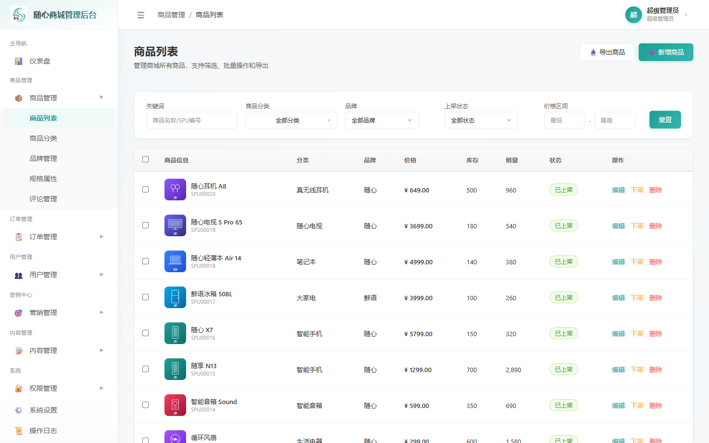
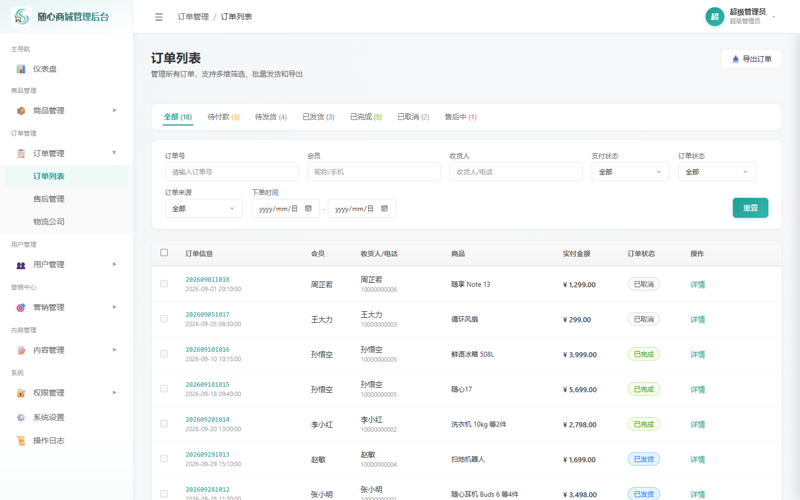
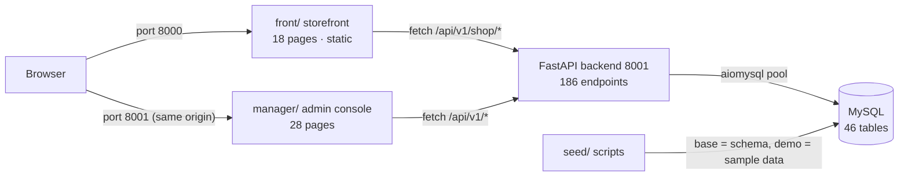
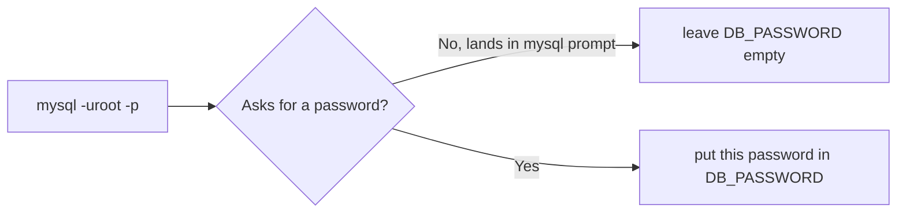

<p align="center">
  <br>
  <sub>Logo © 2026 3EN2SHG1P ｜ terms in <a href="./NOTICE">NOTICE</a> ｜ <a href="./README.md">中文</a></sub>
</p>

<h1 align="center">Suixin Shop</h1>

[](https://github.com/3EN2SHG1P/suixinshop/actions/workflows/ci.yml)

A storefront you can walk end-to-end: browse goods, place an order, then ship it from the admin console. `FastAPI` + `MySQL` fully async backend; both front ends are plain static pages — no framework, no build step, just `Python`.

> **Scope: learning / demo / further development.** Feature coverage is complete, but payments, SMS and scheduled jobs are simulated — not production-ready out of the box. See [#7 Known limitations](#7-known-limitations).

**Sections**: [#1 How it fits together](#1-how-it-fits-together) ｜ [#2 Quick start](#2-quick-start-in-5-minutes) ｜ [#3 What success looks like](#3-what-success-looks-like) ｜ [#4 What you can do](#4-what-you-can-do) ｜ [#5 Troubleshooting](#5-troubleshooting) ｜ [#6 Advanced](#6-advanced) ｜ [#7 Known limitations](#7-known-limitations) ｜ [#8 Docs and layout](#8-docs-and-layout)

---

### Screenshots

---

#### Storefront (8000)

<table border="0" cellspacing="0" cellpadding="0">
<tr>
<td width="50%" style="padding:0 8px 18px 0"><sub>Home: categories, carousel, featured goods</sub></td>
<td width="50%" style="padding:0 8px 18px 0"><sub>Detail: specs drive SKUs, stock and add-to-cart</sub></td>
</tr>
</table>

<table border="0" cellspacing="0" cellpadding="0">
<tr>
<td width="50%" style="padding:0 8px 18px 0"><sub>Cart: selection, quantity, totals</sub></td>
<td width="50%" style="padding:0 8px 18px 0"><sub>My orders: status tabs, after-sales and payment entry</sub></td>
</tr>
</table>

---

#### Admin console (8001)

<table border="0" cellspacing="0" cellpadding="0">
<tr>
<td width="50%" style="padding:0 8px 18px 0"><sub>Login page</sub></td>
<td width="50%" style="padding:0 8px 18px 0"><sub>Dashboard</sub></td>
</tr>
</table>

<table border="0" cellspacing="0" cellpadding="0">
<tr>
<td width="50%" style="padding:0 8px 18px 0"><sub>Goods: filters, batch on/off shelf, export</sub></td>
<td width="50%" style="padding:0 8px 18px 0"><sub>Orders: price adjustment, shipping, after-sales</sub></td>
</tr>
</table>

Screenshots come from a real local run after `seed demo`; accounts and goods are demo data.

---

### Four steps to a running site

**Get the code**: clone the repo

```bash
git clone https://github.com/3EN2SHG1P/suixinshop.git
```

**Install dependencies**: enter the backend folder and install packages (Python 3.10+ and uv required; install uv with `pip install uv` if missing)

```bash
cd suixinshop/backend
uv sync
```

**Fill the config**: copy the template, then edit two lines in a text editor (`JWT_SECRET` required, `DB_PASSWORD` matching your MySQL). Use `cp`; on Windows CMD use `copy`.

```bash
cp .env.example .env
```

Generate a secret with: `python -c "import secrets;print(secrets.token_urlsafe(48))"`

**Create the schema and start**: write base and demo data, then start the backend

```bash
uv run python -m seed.runner base && uv run python -m seed.runner demo
uv run python run.py
```

Then open <http://127.0.0.1:8001>. For the storefront, open another terminal, go back to the repo root and run `cd front && python -m http.server 8000`.

This is the shortest path. The full seven steps (pick a database, fill `.env`, seed, start two terminals) are in [#2](#2-quick-start-in-5-minutes).

**Stuck?** [Troubleshooting](#5-troubleshooting) ｜ **Want to modify code?** [docs/开发指南.md](./docs/开发指南.md) (Chinese)

---

### 1. How it fits together



| Port | What runs there | How to open |
|---|---|---|
| **8001** | API + admin console `manager/` (same-origin hosting) | <http://127.0.0.1:8001> → redirects to login; API docs at <http://127.0.0.1:8001/api/docs> |
| **8000** | Storefront `front/` (static, served separately) | <http://127.0.0.1:8000/> — **no `/front/` prefix** |

The two front ends talk to the API over CORS.

The default allow-list already covers `127.0.0.1` and `localhost` on 8000/8001.

---

### 2. Quick start in 5 minutes

Prerequisites: **Python 3.10+**, **MySQL 5.7+ (8.0 recommended)** or **Docker**. Keep the project path free of non-ASCII characters and spaces.

| Step | Do | Looks right when |
|---|---|---|
| ① | Start a database | `docker compose ps` shows `healthy` |
| ② | Enter `backend/`, install uv and dependencies | `Installed ... packages`, `.venv` created |
| ③ | Copy `.env`, fill two lines | `JWT_SECRET` is not empty |
| ④ | `uv run python -m seed.runner base` | terminal prints the admin password |
| ⑤ | `uv run python -m seed.runner demo` | terminal prints demo data counts |
| ⑥ | `uv run python run.py` | `Uvicorn running on http://127.0.0.1:8001` |
| ⑦ | New terminal: `cd front` → `python -m http.server 8000` | `Serving HTTP on 0.0.0.0 port 8000` |

Steps ⑥⑦ are long-running processes — keep both windows open.

---

#### ① Prepare the database (pick one)

**Option A: Docker (recommended)**, from the repo root:

```bash
docker compose up -d
docker compose ps          # wait for healthy (~30s on first run)
```

<span>&nbsp;•&nbsp;&nbsp;&nbsp;</span>**Starts a MySQL 8**: user `root`, password `DEV_ONLY_123456`, database `suixinshop`

<span>&nbsp;•&nbsp;&nbsp;&nbsp;</span>**In ③, set `.env`**: `DB_PASSWORD` must be `DEV_ONLY_123456`, otherwise `1045 Access denied`

<span>&nbsp;•&nbsp;&nbsp;&nbsp;</span>**Loopback only**: port 3306 is published to `127.0.0.1` by default, so GUI clients must connect to `127.0.0.1:3306`; connecting to another address fails with `2003 ... (10061)`. To reach it from a LAN address, set `DB_BIND_HOST` as described in `docker-compose.yml`, rerun `docker compose up -d`, and open the port in your firewall

**Option B: Local MySQL**, start the service, then run `mysql -uroot -p` and note the result (`.env` is only created in ③):



<span>&nbsp;•&nbsp;&nbsp;&nbsp;</span>**The password in the diagram**: your local MySQL root password (set when installing MySQL), not the admin console password

<span>&nbsp;•&nbsp;&nbsp;&nbsp;</span>**How to fill it**: in ③, open `.env` in a text editor and write `DB_PASSWORD=` as empty or this password

<span>&nbsp;•&nbsp;&nbsp;&nbsp;</span>**What you don't do**: never run `CREATE DATABASE`; ④ creates schema and tables

---

#### ② Install dependencies

**Enter the backend folder** (every later command runs from here)

```bash
cd backend
```

**Install uv** (skip this block if uv is already installed; on PowerShell replace `pip` with `python -m pip`)

```bash
pip install uv
```

**Install project dependencies**

```bash
uv sync
```

Reopen the terminal afterwards, otherwise `uv` may not be found — `cd backend` again before continuing.

---

#### ③ Fill in the config (two lines, mandatory)

**Copy the config template** (run inside `backend/`; use `copy` on Windows CMD, `cp` in PowerShell and on macOS/Linux)

```bash
copy .env.example .env
```

**Generate a random secret** (filled into `JWT_SECRET` next)

```bash
python -c "import secrets;print(secrets.token_urlsafe(48))"
```

Edit `.env` (the file lives in the `backend/` folder you just entered), change only these two lines:

```
JWT_SECRET=<paste the generated value here, required>
DB_PASSWORD=<per step ①: DEV_ONLY_123456 for Docker>
```

An empty `JWT_SECRET` fails startup immediately. Leave the rest at defaults.

---

#### ④⑤ Seed the data (both steps required)

**Create schema + base data** (permission tree, admin account, dictionaries)

```bash
uv run python -m seed.runner base
```

**Load demo data** (34 goods / 31 categories / 18 orders / 6 members)

```bash
uv run python -m seed.runner demo
```

<span>&nbsp;•&nbsp;&nbsp;&nbsp;</span>**`base` alone is not enough**: the storefront will be empty.

<span>&nbsp;•&nbsp;&nbsp;&nbsp;</span>**Both commands are idempotent**: rerunning only fills gaps.

<span>&nbsp;•&nbsp;&nbsp;&nbsp;</span>**`seed base` prints a random admin password once**: `已创建默认管理员 admin，初始密码：xxxxxx`, copy it, you need it in ⑥

<span>&nbsp;•&nbsp;&nbsp;&nbsp;</span>**To pin it**: set `ADMIN_INIT_PASSWORD` in `.env` and rerun `seed base` (overwrites the current password)

---

#### ⑥⑦ Run it (two terminals)

**Terminal 1: backend + admin console** (new terminal, starting from the repo root)

```bash
cd backend && uv run python run.py
```

**Terminal 2: storefront** (another terminal, also from the repo root)

```bash
cd front && python -m http.server 8000
```

On macOS/Linux use `python3` if `python` is not found.

---

### 3. What success looks like

#### Accounts you need

<table>
<tr><th width="18%" style="padding:8px 10px">Side</th><th width="38%" style="padding:8px 10px">Account</th><th style="padding:8px 10px">Password</th></tr>
<tr><td style="padding:8px 10px">Admin console</td><td style="padding:8px 10px"><code>admin</code></td><td style="padding:8px 10px">the random password printed by <code>seed base</code></td></tr>
<tr><td style="padding:8px 10px">Demo members</td><td style="padding:8px 10px"><code>10000000001</code> / <code>10000000002</code> / <code>10000000003</code></td><td style="padding:8px 10px"><code>123456</code></td></tr>
</table>

<hr style="border:none;border-top:1px dashed #d0d0d0;margin:-2px 0 8px">

<span>&nbsp;&nbsp;&nbsp;</span>**Note:**<br/>
<span>&nbsp;&nbsp;&nbsp;</span>Forgot the admin password:&nbsp;&nbsp;set <code>ADMIN_INIT_PASSWORD</code> in <code>.env</code> and rerun <code>seed base</code><span style="display:inline-block;height:8px"></span><br/>
<span>&nbsp;&nbsp;&nbsp;</span>No signup code on the storefront:&nbsp;&nbsp;the code is shown on the page when <code>SMS_MOCK=true</code>

<hr style="border:none;border-top:1px solid #d8d8d8;margin:-4px 0 12px">

#### Verify each item

<span>&nbsp;•&nbsp;&nbsp;&nbsp;</span>**Open the console**: <http://127.0.0.1:8001> redirects to the login page

<span>&nbsp;•&nbsp;&nbsp;&nbsp;</span>**Log in**: `admin` plus the printed password lands you on the dashboard (7 menu groups / 9 top-level menus)

<span>&nbsp;•&nbsp;&nbsp;&nbsp;</span>**API is alive**: <http://127.0.0.1:8001/api/v1/health> contains `"db":"up"`

<span>&nbsp;•&nbsp;&nbsp;&nbsp;</span>**Open the storefront**: <http://127.0.0.1:8000/> shows the home page with images, prices, categories

<span>&nbsp;•&nbsp;&nbsp;&nbsp;</span>**Walk one order**: pick a good → add to cart → checkout → submit → pay

<table border="0" cellspacing="0" cellpadding="0">
<tr>
<td width="50%" align="center" style="padding:0 8px 18px 0"><sub>Admin dashboard after login</sub></td>
<td width="50%" align="center" style="padding:0 8px 18px 0"><sub>Storefront cart</sub></td>
</tr>
</table>

The order shows up under "My orders" (mock payment, no real money).

All five green means you are done. Otherwise jump to [#5](#5-troubleshooting).

---

### 4. What you can do

#### Admin console (9 modules)

Nine top-level menus, one row per module. Per-page detail: [功能清单](./docs/功能清单.md) (Chinese). Step-by-step recipes: [操作手册](./docs/操作手册.md) (Chinese).

| Module | What it does |
|---|---|
| Dashboard | Today's orders / GMV / new members / goods on sale / pending payment / pending shipment / low stock, sales trend, hot list, recent orders |
| Goods | Create and edit goods with SKUs, categories, brands, specs and attributes, comment moderation and replies, batch on/off shelf, export |
| Orders | List and detail, price adjustment, shipping and batch shipping, cancel, after-sales review, carriers and tracking fields |
| Members | Member CRUD, enable/disable, password reset, levels, points adjustment and ledger, member logs |
| Marketing | Coupons and redemption records, seckill, full-discount, group-buy, distributors and commissions |
| Content | Articles and article categories, ad slots and ads, notices |
| Settings | Grouped system config, freight templates |
| Permissions | Admins, roles (copyable), permission tree and resources, departments, login logs |
| Logs | Operation log search and export |

#### Storefront (shopping loop)

`home` → `search` / `detail` (specs drive SKUs) → `add to cart` / `cart` → `checkout` → `address` → `submit` → `cashier` → `mock QR payment` → `my orders`

After-sales, coupons and points hang off the orders page; login, register and the service center run through the whole flow.

---

### 5. Troubleshooting

Most failures come down to two things: **wrong working directory** or **wrong `.env`**.

| Symptom | Fix |
|---|---|
| `python` is not recognized | Python installer without "Add python.exe to PATH"; rerun it. macOS/Linux: use `python3` |
| `uv` is not recognized | Reopen the terminal after installing uv; or `python -m pip install uv` |
| `can't open file 'run.py'` / `ModuleNotFoundError` | You are not in `backend/` |
| `缺少必填环境变量: JWT_SECRET` | No `.env`, or `JWT_SECRET` is empty — see step ③ |
| `Can't connect to MySQL` | Database not running: `docker compose up -d`, or start the local MySQL service |
| `Access denied for user 'root'` | `DB_PASSWORD` mismatch: `DEV_ONLY_123456` for Docker, empty for passwordless local root |
| `docker compose up -d` port conflict | Local MySQL already holds 3306 — use it instead, or stop it |
| `Unknown database 'suixinshop'` | Seed not run: `uv run python -m seed.runner base` |
| Storefront loads but has **no goods** | Only `base` was run: add `uv run python -m seed.runner demo` |
| `127.0.0.1:8000` unreachable | Start the static server (step ⑦) and open the root path, no `/front/` |
| Blank page / CORS errors | Backend not running, or ports changed without updating `CORS_ORIGINS` |
| `uv sync` hangs | Use a mirror: `$env:UV_DEFAULT_INDEX='https://pypi.tuna.tsinghua.edu.cn/simple'; uv sync` (do not edit `pyproject.toml` / `uv.lock`) |
| Error contains `uv trampoline failed to canonicalize script path` | Two causes: ① the project path contains non-ASCII characters or spaces — move the repo to an ASCII-only path, reopen the terminal, then run `uv sync`; ② the repo was renamed or moved, and the launchers inside `backend/.venv` still point at the old path — delete `backend/.venv` and run `uv sync` again |
| Admin login rejected | Password is the one printed on first `seed base`; see "Forgot the admin password" under [#3](#3-what-success-looks-like) |
| `pytest` errors everywhere | Needs a real MySQL with both `base` and `demo`, plus `ADMIN_INIT_PASSWORD` matching the current admin password |
| `.env` changes ignored | Restart the backend (`Ctrl+C`, then `run.py` again) |

<details>
<summary><b>Port already in use / change the port</b></summary>

| OS | Find the owner | Kill it |
|---|---|---|
| Windows | `netstat -ano \| findstr :8001` | `taskkill /PID <last column> /F` |
| macOS / Linux | `lsof -i :8001` | `kill -9 <PID>` |

When actually changing the port, update three places: `.env` `PORT` and `CORS_ORIGINS`; `UPLOAD_PUBLIC_BASE` (then `clean-demo` + `demo` because demo image URLs embed the port); the storefront via `localStorage.setItem('shop_api_base','http://127.0.0.1:<new port>/api/v1')`.

</details>

---

### 6. Advanced

**Reference (env vars, endpoints, tables, test prerequisites)** → [docs/api-reference.md](./docs/api-reference.md) (Chinese)

**Reset data** (run in `backend/`, all idempotent)

**Demo data only** (goods, orders, members; base data and accounts stay)

```bash
uv run python -m seed.runner clean-demo
```

**Base data only** (admins, roles, permissions)

```bash
uv run python -m seed.runner clean-base
```

Fresh state: `clean-demo` → `clean-base` → `base` → `demo`.

**Tests**:

Run inside `backend/`:

```bash
uv run pytest -q tests
```

Three prerequisites, all required:

<span>&nbsp;•&nbsp;&nbsp;&nbsp;</span>**MySQL**: reachable, with `base` + `demo` applied

<span>&nbsp;•&nbsp;&nbsp;&nbsp;</span>**`JWT_SECRET`**: set in `.env`

<span>&nbsp;•&nbsp;&nbsp;&nbsp;</span>**Admin password**: `ADMIN_INIT_PASSWORD` matches the current admin password (rerun `seed base` if not)

Tests hit the real database with no rollback, so they leave data behind.

---

### 7. Known limitations

Concurrency control, permission checks, money precision and upload safety follow production practice (see the safeguards table in [SECURITY.md](./SECURITY.md)). The items below are implemented to demo standards only, so **this is not production-ready out of the box**. They fall into three buckets:

<span>&nbsp;•&nbsp;&nbsp;&nbsp;</span>**Not connected**: payment gateway, SMS provider, schema migration tooling, logistics tracking

<span>&nbsp;•&nbsp;&nbsp;&nbsp;</span>**Not resident**: scheduled jobs (unpaid orders expire lazily), multi-process deployment, rate limiting and monitoring

<span>&nbsp;•&nbsp;&nbsp;&nbsp;</span>**Not deep**: marketing activities are not wired into checkout; `data_scope` row filtering covers goods and admin accounts only

The table is ordered by impact, not by effort — work from the top when developing further.

| Limitation | Note |
|---|---|
| Money precision | Amounts are `DECIMAL(10,2)`; calculations quantize via `core/money.py` (`Decimal` + `ROUND_HALF_UP`). JSON responses still emit `float` for the front end — reconcile via the database |
| Stock concurrency | SKU stock uses a single conditional decrement `UPDATE ... WHERE stock >= N`, so it cannot go negative; no distributed lock, no load-test evidence |
| Checkout token | `previewToken` lives in process memory: single instance only, lost on restart, not shared across replicas (use Redis in production) |
| Unpaid order timeout | No cron job: an unpaid order is only expired when the member opens its detail, pays, or polls the pay status, so the admin list will not close it on its own |
| SMS | No provider SDK bundled; with `SMS_MOCK=false` registration is unavailable |
| Payments | WeChat / Alipay are simulated; no gateway. Members can mark their own order as paid |
| Coupon limits | `UNIQUE(coupon_id, member_id)` means `per_limit > 1` has no effect |
| Freight templates | Full CRUD, but `freight_amount` is always 0 at checkout |
| Marketing | Seckill / full-discount / group-buy are CRUD plus seckill price; stock limits, per-user caps and stacking are not wired into checkout |
| After-sales refund | "Approve refund" only moves the status; no real refund, coupons and points are not returned |
| Points | Not granted on payment; only manual admin adjustment and cancel-order return |
| Page views | `POST /goods/{id}/visit` exists but writes nothing |
| Database | MySQL only (aiomysql); no SQLite mode, pytest needs a real MySQL |
| Static hosting | `/manager` and `/uploads` are served unauthenticated; put Nginx in front in production |
| Data scope | `data_scope` row filtering applies only to goods and admin accounts; orders / members / marketing are function-level RBAC |
| Product images | All hand-drawn SVG placeholders, not real photos |

<details>
<summary><b>Two boundaries of the permission model</b></summary>

1. **`data_scope`**: `1` self / `2` own department and below / `3` all; multiple roles take the widest. It is enforced only on goods (list, export, detail, edit, delete, batch, audit — single-record reads and writes are filtered too) and admin accounts (list and detail narrowed by `dept_id` / `id`). Orders, members and marketing check permission codes only, no row filtering — a deliberate boundary, not an omission.
2. **Writing roles and permission resources is super-admin only** (`data_scope=3`): roles carry permissions, so letting a regular role holder edit them would hand over the ability to grant. Regular admins can still create accounts and edit their own profile, but the role field they submit is discarded.

</details>

---

### 8. Docs and layout

| I want to… | Read |
|---|---|
| Find the right doc | [docs/README.md](./docs/README.md) (doc index, Chinese) |
| Get it running | [#2](#2-quick-start-in-5-minutes) above |
| Know what each page does | [docs/功能清单.md](./docs/功能清单.md) (Chinese) |
| Read the original requirements and planned-but-missing details | [docs/需求规划.md](./docs/需求规划.md) (Chinese) |
| Learn daily operations (goods, shipping, coupons, RBAC) | [docs/操作手册.md](./docs/操作手册.md) (Chinese) |
| Modify code / add endpoints or tables | [docs/开发指南.md](./docs/开发指南.md) (Chinese) |
| Work on the admin console front end | [manager/README.md](./manager/README.md) (Chinese) |
| Look up env vars, endpoints, tables | [docs/api-reference.md](./docs/api-reference.md) (Chinese) |
| Browse every endpoint without running the backend | [docs/openapi.json](./docs/openapi.json) (136 paths / 186 operations) |
| Release history | [CHANGELOG.md](./CHANGELOG.md) (Chinese) |
| Contribution / security | [CONTRIBUTING.md](./CONTRIBUTING.md) ｜ [SECURITY.md](./SECURITY.md) |

Every document under `docs/` is written in Chinese; the two READMEs are the only bilingual entry points.

```
suixinshop/
├── backend/                # FastAPI service (8001)
│   ├── app/                # main.py + core/ + routers/ + services/ + schemas/
│   ├── seed/               # schema.py, base.py, demo.py
│   ├── tests/              # pytest
│   ├── .env.example        # template only; the real .env is never committed
│   ├── pyproject.toml      # deps + uv config (requirements*.txt for pip users)
│   └── run.py
├── manager/                # admin console static pages (served by 8001)
├── front/                  # storefront static pages (served on 8000)
├── uploads/                # runtime uploads (seed/ images are generated by seed demo, not committed)
├── docs/                   # doc index / feature list / manual / requirements / dev guide / API reference + ER / OpenAPI snapshot / screenshots
├── .github/                # CI, issue and PR templates
├── docker-compose.yml      # MySQL 8 in one command
└── README.md / README.en.md / CHANGELOG.md / CONTRIBUTING.md / SECURITY.md / LICENSE / NOTICE
```

---

### Disclaimer

A storefront built for learning, demos and further development, released under the [MIT License](./LICENSE). You may use it as an admin-console base for your own project; if you deploy it to production, security hardening, compliance and operations are your own responsibility.

All brand names, product names and product images in this repository are placeholder demo data. They exist to demonstrate the system and are not affiliated with, nor an endorsement of, any real brand or vendor.

Product images are hand-drawn SVGs with no third-party assets. The site logo (`front/images/logo.png`, `front/images/logo-transparent.png`, `manager/images/logo.png`, `manager/images/logo-transparent.png`) is an original artwork designed solely by the project author, who has filed for copyright registration; it is owned by the author and is **not covered by this project's MIT License**. Permitted: redistribution together with this repository's source, in-app display, quoting in screenshots, articles, courses and reviews, and reuse within derivative works. Prohibited: using it as the identity of another project, registering it as a trademark or trade name, altering the artwork itself, or redistributing it as a standalone asset. Full terms in [NOTICE](./NOTICE); the permission is irrevocable for released versions.

Product names and model numbers are fictional; any resemblance to real models is coincidental. If you believe something infringes your rights, open an issue and we will act promptly.

**Before deploying publicly**, do all four:

<span>&nbsp;•&nbsp;&nbsp;&nbsp;</span>**Rotate secrets**: `JWT_SECRET`, `MEMBER_JWT_SECRET`, the database password, the admin password

<span>&nbsp;•&nbsp;&nbsp;&nbsp;</span>**Disable mock SMS**: set `SMS_MOCK=false`

<span>&nbsp;•&nbsp;&nbsp;&nbsp;</span>**Tighten CORS**: `CORS_ORIGINS` limited to your own origins

<span>&nbsp;•&nbsp;&nbsp;&nbsp;</span>**Guard static dirs**: access control in front of `/manager` and `/uploads`
