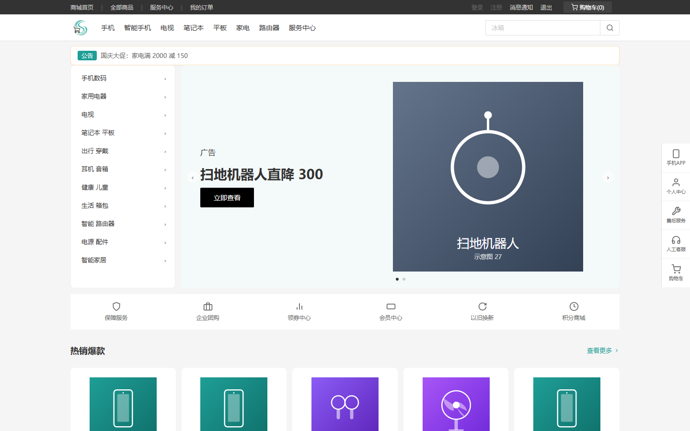
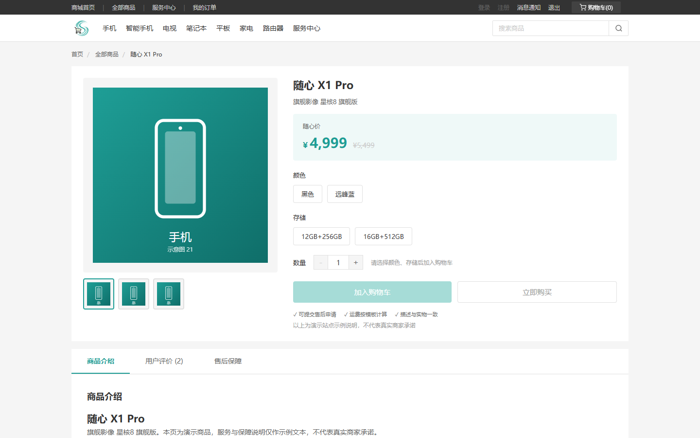
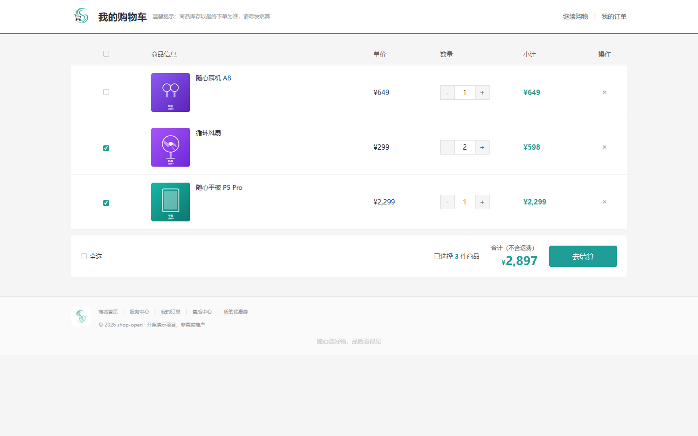
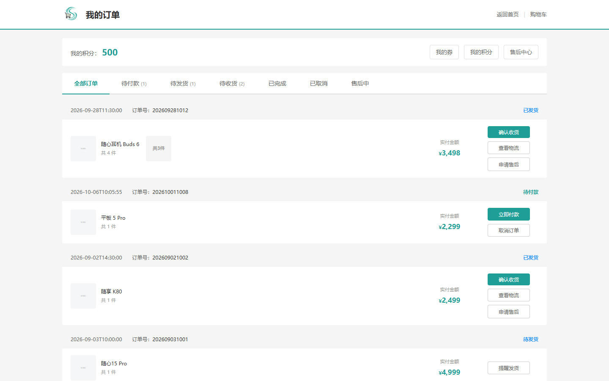
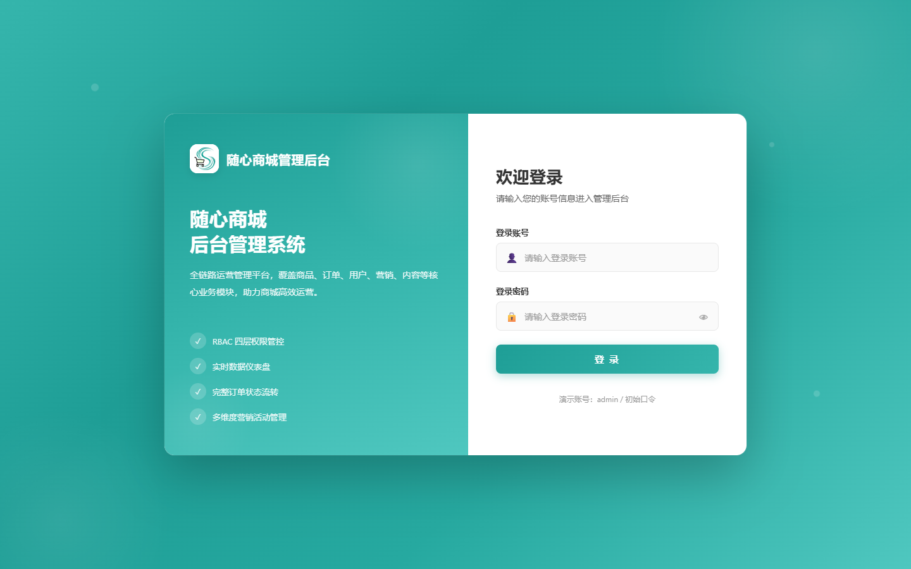
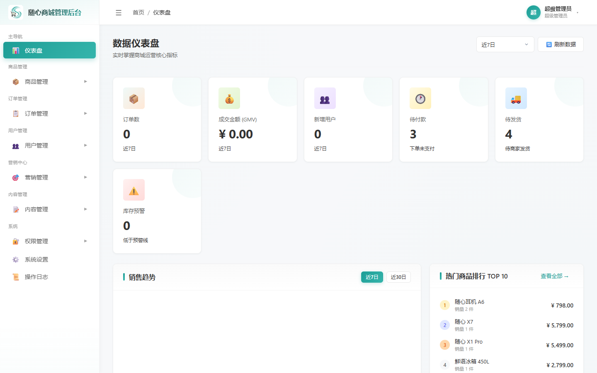
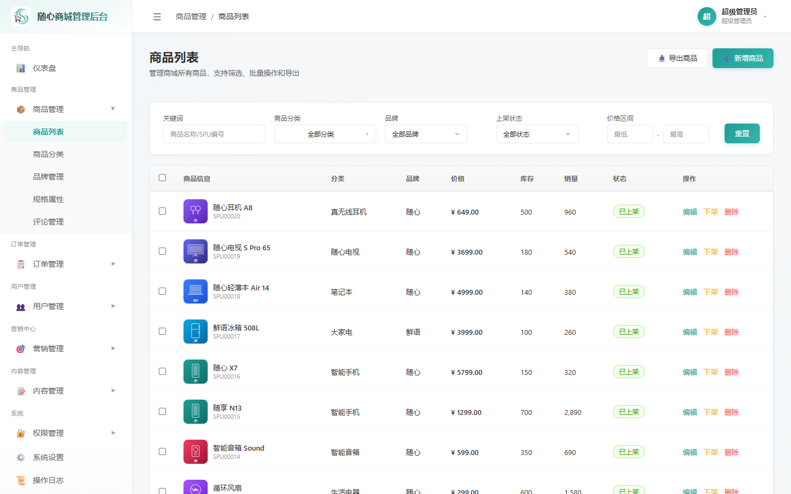
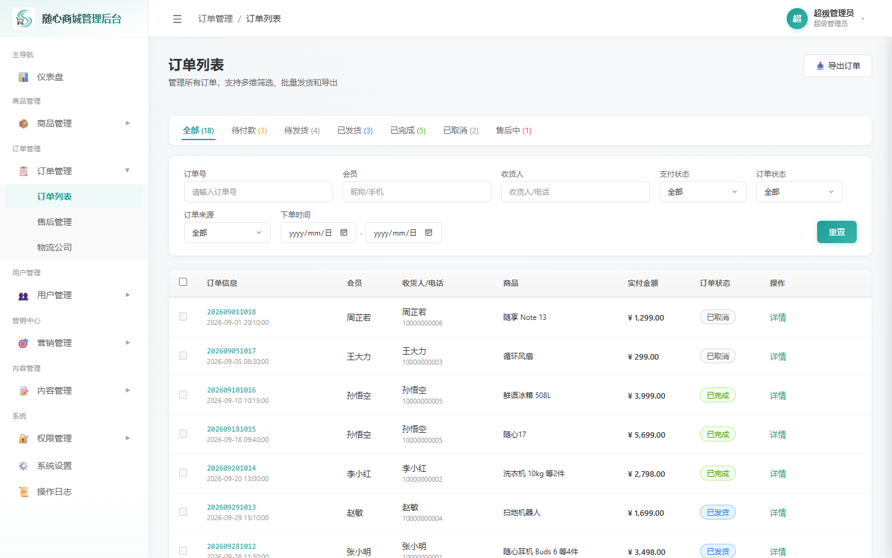
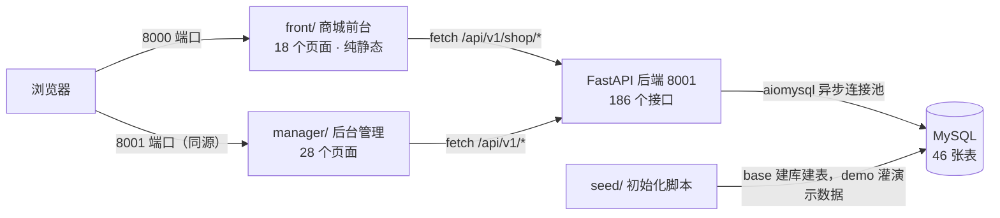
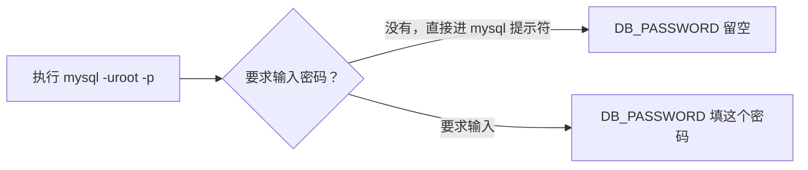

<p align="center">
  <br>
  <sub>Logo © 2026 3EN2SHG1P ｜ 使用范围见 <a href="./NOTICE">NOTICE</a> ｜ <a href="./README.en.md">English</a></sub>
</p>

<h1 align="center">随心商城</h1>

[](https://github.com/3EN2SHG1P/suixinshop/actions/workflows/ci.yml)

一套从「逛商品」到「后台发货」都能走通的商城系统。`FastAPI` + `MySQL` 全异步后端，前台和后台都是纯静态页面 —— 不用框架、不用构建，装个 `Python` 就能打开。

> **定位：学习 / 演示 / 二次开发用途。** 功能覆盖完整，支付、短信、定时任务等关键件为演示实现，开箱不可直接上生产 —— 差异清单见 [#7 已知限制](#7-已知限制)。

**章节**：[#1 长什么样](#1-长什么样) ｜ [#2 跑起来](#2-5-分钟跑起来) ｜ [#3 验证](#3-看到什么算成功) ｜ [#4 能做什么](#4-能做什么) ｜ [#5 排错](#5-跑不起来怎么办) ｜ [#6 进阶](#6-进阶) ｜ [#7 限制](#7-已知限制) ｜ [#8 文档](#8-文档地图)

---

### 界面预览

---

#### 商城前台（8000）

<table border="0" cellspacing="0" cellpadding="0">
<tr>
<td width="50%" style="padding:0 8px 18px 0"><sub>首页：分类、轮播、推荐商品</sub></td>
<td width="50%" style="padding:0 8px 18px 0"><sub>详情：规格联动 SKU、库存与加购</sub></td>
</tr>
</table>

<table border="0" cellspacing="0" cellpadding="0">
<tr>
<td width="50%" style="padding:0 8px 18px 0"><sub>购物车：勾选、改数量、算总价</sub></td>
<td width="50%" style="padding:0 8px 18px 0"><sub>我的订单：状态分页、售后与支付入口</sub></td>
</tr>
</table>

---

#### 后台管理（8001）

<table border="0" cellspacing="0" cellpadding="0">
<tr>
<td width="50%" style="padding:0 8px 18px 0"><sub>登录页</sub></td>
<td width="50%" style="padding:0 8px 18px 0"><sub>仪表盘</sub></td>
</tr>
</table>

<table border="0" cellspacing="0" cellpadding="0">
<tr>
<td width="50%" style="padding:0 8px 18px 0"><sub>商品管理</sub></td>
<td width="50%" style="padding:0 8px 18px 0"><sub>订单管理</sub></td>
</tr>
</table>

截图均来自本地运行 `seed demo` 后的真实界面，账号与商品都是演示数据。

---

### 四步跑起来

**拿代码**：把仓库拉到本地

```bash
git clone https://github.com/3EN2SHG1P/suixinshop.git
```

**装依赖**：进后端目录装 Python 包（需 Python 3.10+ 与 uv；没装 uv 先 `pip install uv`）

```bash
cd suixinshop/backend
uv sync
```

**填配置**：复制模板，再用记事本填两行（`JWT_SECRET` 必填、`DB_PASSWORD` 对上你的 MySQL）。Windows 用 `copy`，macOS/Linux 换成 `cp`

```bash
copy .env.example .env
```

生成密钥的命令：`python -c "import secrets;print(secrets.token_urlsafe(48))"`

**建库并启动**：写入基础数据与演示数据，然后启动后端

```bash
uv run python -m seed.runner base && uv run python -m seed.runner demo
uv run python run.py
```

启动后打开 <http://127.0.0.1:8001>。商城前台要另开一个终端，回到仓库根目录执行 `cd front && python -m http.server 8000`。

这只是最短路径。完整七步（选数据库、配 `.env`、seed、双终端启动）见 [#2](#2-5-分钟跑起来)。

**卡住了？** [跑不起来怎么办](#5-跑不起来怎么办) ｜ **想改代码？** [docs/开发指南.md](./docs/开发指南.md)

---

### 1. 长什么样



| 端口 | 谁在跑 | 怎么访问 |
|---|---|---|
| **8001** | 后端 API + 后台管理 `manager/`（同源托管） | <http://127.0.0.1:8001> → 自动跳登录页；接口文档 <http://127.0.0.1:8001/api/docs> |
| **8000** | 商城前台 `front/`（纯静态，独立托管） | <http://127.0.0.1:8000/> —— **没有 `/front/` 前缀** |

前台与后端不同源，靠 CORS 通信。

默认白名单已包含 `127.0.0.1` 与 `localhost` 的 8000/8001，不用改配置。

---

### 2. 5 分钟跑起来

前置：**Python 3.10+**、**MySQL 5.7+（推荐 8.0）** 或 **Docker**。项目路径不要带中文和空格。

| 步 | 做什么 | 跑对了是什么样 |
|---|---|---|
| ① | 起数据库 | `docker compose ps` 显示 `healthy` |
| ② | 进 `backend/`，装 uv 与项目依赖 | 出现 `Installed ... packages`，多出 `.venv` |
| ③ | 复制 `.env`，填两行 | `JWT_SECRET` 不为空 |
| ④ | `uv run python -m seed.runner base` | 终端打印 admin 初始密码 |
| ⑤ | `uv run python -m seed.runner demo` | 终端打印演示数据条数 |
| ⑥ | `uv run python run.py` | `Uvicorn running on http://127.0.0.1:8001` |
| ⑦ | 另开终端：`cd front` → `python -m http.server 8000` | `Serving HTTP on 0.0.0.0 port 8000` |

⑥⑦ 两个窗口都是长驻进程，**不能关**。下面是每一步的细节。

---

#### ① 准备数据库（二选一）

**方案 A：Docker（推荐）**，在项目根目录执行：

```bash
docker compose up -d
docker compose ps          # 状态显示 healthy 才算就绪（首次约 30 秒）
```

<span>&nbsp;•&nbsp;&nbsp;&nbsp;</span>**会起一个 MySQL 8**：账号 `root`、密码 `DEV_ONLY_123456`、库名 `suixinshop`

<span>&nbsp;•&nbsp;&nbsp;&nbsp;</span>**到 ③ 填 `.env`**：`DB_PASSWORD` 必须写 `DEV_ONLY_123456`，否则报 `1045 Access denied`

<span>&nbsp;•&nbsp;&nbsp;&nbsp;</span>**只能本机连**：3306 默认只发布到 `127.0.0.1`，Navicat / DBeaver 等客户端连 `127.0.0.1:3306`。绑到别的地址连会报 `2003 ... (10061)`；要用本机局域网 IP 连，按 `docker-compose.yml` 里 `DB_BIND_HOST` 的注释设置后 `docker compose up -d` 重建，并配防火墙

**方案 B：本机 MySQL**，启动服务后执行 `mysql -uroot -p`，先按结果记下该填什么（`.env` 到 ③ 才建）：



<span>&nbsp;•&nbsp;&nbsp;&nbsp;</span>**图里的密码**：你本机 MySQL 的 root 密码（装 MySQL 时设的），不是后台 admin 的密码

<span>&nbsp;•&nbsp;&nbsp;&nbsp;</span>**怎么填**：到 ③ 用记事本打开 `.env`，把 `DB_PASSWORD=` 后面写成「留空」或「这个密码」

<span>&nbsp;•&nbsp;&nbsp;&nbsp;</span>**不用做什么**：不用手工 `CREATE DATABASE`，④ 会自动建库建表

---

#### ② 装依赖

**进后端目录**（后面的命令都在这里执行）

```bash
cd backend
```

**装 uv**（已装过就跳过这一块；PowerShell 报「pip 不是内部或外部命令」时把 `pip` 换成 `python -m pip`）

```bash
pip install uv
```

**装项目依赖**

```bash
uv sync
```

装完**关掉终端重新打开**，否则可能提示找不到 `uv`；重开后先 `cd backend` 再继续往下走。

---

#### ③ 填配置（两行，必做）

**复制一份配置模板**（在 `backend/` 目录下执行。Windows CMD 用 `copy`；PowerShell、macOS、Linux 用 `cp`）

```bash
copy .env.example .env
```

**生成一串随机密钥**（下一步填进 `JWT_SECRET`）

```bash
python -c "import secrets;print(secrets.token_urlsafe(48))"
```

用记事本打开 `.env`（就在刚才 `cd` 进去的 `backend/` 目录下），只改这两行：

```
JWT_SECRET=<把上一条命令的输出粘这里，必填>
DB_PASSWORD=<按 ① 的结论填，Docker 是 DEV_ONLY_123456>
```

`JWT_SECRET` 留空 → 启动直接报「缺少必填环境变量」。其余变量保持默认。

---

#### ④⑤ 初始化数据（两步都要跑）

**建表 + 基础数据**（权限树、管理员、字典数据）

```bash
uv run python -m seed.runner base
```

**灌演示数据**（34 商品 / 31 分类 / 18 订单 / 6 会员）

```bash
uv run python -m seed.runner demo
```

<span>&nbsp;•&nbsp;&nbsp;&nbsp;</span>**只跑 `base` 不行**：前台会是空的。

<span>&nbsp;•&nbsp;&nbsp;&nbsp;</span>**两条命令都幂等**：重复执行只补缺失。

<span>&nbsp;•&nbsp;&nbsp;&nbsp;</span>**`seed base` 会随机生成 admin 密码并打印**：形如 `已创建默认管理员 admin，初始密码：xxxxxx`，抄下来，⑥ 登录要用

<span>&nbsp;•&nbsp;&nbsp;&nbsp;</span>**想固定密码**：`.env` 里填 `ADMIN_INIT_PASSWORD=你的密码`，再重跑 `seed base`（会覆盖现有密码）

---

#### ⑥⑦ 启动（两个终端窗口）

**终端 1：后端 + 后台管理**（新开一个终端，从仓库根目录进入）

```bash
cd backend && uv run python run.py
```

**终端 2：商城前台**（再开一个终端，同样从仓库根目录进入）

```bash
cd front && python -m http.server 8000
```

macOS/Linux 若报 command not found，把 `python` 换成 `python3`。

---

### 3. 看到什么算成功

#### 登录要用的账号

<table>
<tr><th width="14%" style="padding:8px 10px">端</th><th width="36%" style="padding:8px 10px">账号</th><th style="padding:8px 10px">密码</th></tr>
<tr><td style="padding:8px 10px">后台管理</td><td style="padding:8px 10px"><code>admin</code></td><td style="padding:8px 10px"><code>seed base</code> 首次运行打印的随机密码</td></tr>
<tr><td style="padding:8px 10px">前台演示会员</td><td style="padding:8px 10px"><code>10000000001</code> / <code>10000000002</code> / <code>10000000003</code></td><td style="padding:8px 10px"><code>123456</code></td></tr>
</table>

<hr style="border:none;border-top:1px dashed #d0d0d0;margin:-2px 0 8px">

<span>&nbsp;&nbsp;&nbsp;</span>**注意：**<br/>
<span>&nbsp;&nbsp;&nbsp;</span>后台密码忘了：&nbsp;&nbsp;<code>.env</code> 里设 <code>ADMIN_INIT_PASSWORD=你的密码</code>，重跑 <code>seed base</code> 覆盖<span style="display:inline-block;height:8px"></span><br/>
<span>&nbsp;&nbsp;&nbsp;</span>前台注册收不到验证码：&nbsp;&nbsp;<code>SMS_MOCK=true</code> 时验证码直接显示在页面上，不真实发短信

<hr style="border:none;border-top:1px solid #d8d8d8;margin:-4px 0 12px">

#### 逐项验证

<span>&nbsp;•&nbsp;&nbsp;&nbsp;</span>**打开后台**：<http://127.0.0.1:8001> 自动跳转到登录页

<span>&nbsp;•&nbsp;&nbsp;&nbsp;</span>**登录**：`admin` + 上面抄下的密码，进来是仪表盘（左侧 7 个分组、9 个一级菜单）

<span>&nbsp;•&nbsp;&nbsp;&nbsp;</span>**接口活着**：打开 <http://127.0.0.1:8001/api/v1/health>，返回内容里含 `"db":"up"`

<span>&nbsp;•&nbsp;&nbsp;&nbsp;</span>**打开前台**：<http://127.0.0.1:8000/> 是商城首页，有商品图、价格、分类

<span>&nbsp;•&nbsp;&nbsp;&nbsp;</span>**走一单**：挑商品 → 加购 → 结算 → 提交订单 → 支付

<table border="0" cellspacing="0" cellpadding="0">
<tr>
<td width="50%" align="center" style="padding:0 8px 18px 0"><sub>登录成功后的后台仪表盘</sub></td>
<td width="50%" align="center" style="padding:0 8px 18px 0"><sub>前台加购后的购物车</sub></td>
</tr>
</table>

订单列表里出现这笔新订单（演示支付，不扣真钱）。

五项全对就是跑通了。任何一项不对，跳 [#5](#5-跑不起来怎么办)。

---

### 4. 能做什么

#### 后台管理（9 个模块）

后台共 9 个一级菜单，一行一个模块。逐项功能见 [功能清单](./docs/功能清单.md)，操作步骤见 [操作手册](./docs/操作手册.md)。

| 模块 | 能干什么 |
|---|---|
| 仪表盘 | 今日订单 / GMV / 新增会员 / 在售商品 / 待付款 / 待发货 / 库存预警、销售趋势、热销榜、最近订单 |
| 商品 | 商品发布与编辑（含 SKU 与规格）、分类、品牌、规格属性、评价审核与回复、批量上下架、导出 |
| 订单 | 订单列表与详情、改价、发货与批量发货、取消、售后审核与确认收货、物流公司与物流详情 |
| 会员 | 会员列表与编辑、启停、重置密码、会员等级、积分调整与流水、会员日志 |
| 营销 | 优惠券与领取记录、秒杀、满减满折、拼团、分销商与佣金 |
| 内容 | 文章与文章分类、广告位与广告、公告 |
| 设置 | 系统配置分组编辑、运费模板 |
| 权限 | 管理员、角色（可复制）、权限树与资源、部门、登录日志 |
| 日志 | 操作日志查询与导出 |

#### 商城前台（购物闭环）

`首页` → `搜索` / `详情`（选规格联动 SKU）→ `加购` / `购物车` → `结算` → `收货地址` → `提交订单` → `收银台` → `模拟扫码支付` → `我的订单`

订单页另有售后、优惠券、积分三个入口；登录、注册、服务中心贯穿全程。

---

### 5. 跑不起来怎么办

绝大多数问题出在两件事上：**没 cd 到正确目录**、**`.env` 没填对**。先确认这两点，再查下表。

| 症状 | 处理 |
|---|---|
| `python` 不是内部或外部命令 | 装 Python 时没勾「Add python.exe to PATH」，重跑安装包补勾；macOS/Linux 用 `python3` |
| `uv` 命令不存在 | 装完 uv 要**重开终端**；或 `python -m pip install uv` |
| `can't open file 'run.py'` / `ModuleNotFoundError` | 没 cd 到 `backend/` 目录 |
| 启动报「缺少必填环境变量: JWT_SECRET」 | 没建 `.env` 或 `JWT_SECRET` 为空，见 [#2](#2-5-分钟跑起来) 第 ③ 步 |
| 报错含 `Can't connect to MySQL` | MySQL 没起：Docker 路线 `docker compose up -d`；本机路线启动 MySQL 服务 |
| 报错含 `Access denied for user 'root'` | `DB_PASSWORD` 与真实密码不一致：Docker 路线应为 `DEV_ONLY_123456`，本机 root 无密码必须留空 |
| `docker compose up -d` 报端口被占用 | 本机已装 MySQL 占了 3306，改用本机 MySQL，或先停掉本机服务 |
| 报错含 `Unknown database 'suixinshop'` | 没跑 seed，执行 `uv run python -m seed.runner base`（会自动建库） |
| 前台能开但**没有商品** | 只跑了 `base`，补跑 `uv run python -m seed.runner demo` |
| `127.0.0.1:8000` 打不开 | 前台要单独起静态服务（[#2](#2-5-分钟跑起来) ⑦），且直接访问根路径，没有 `/front/` |
| 前台页面空白 / 控制台报 CORS | 后端没起（8001），或改过端口后没同步 `.env` 的 `CORS_ORIGINS` |
| `uv sync` 卡住 / 极慢 | 临时走镜像：`$env:UV_DEFAULT_INDEX='https://pypi.tuna.tsinghua.edu.cn/simple'; uv sync`（别改 `pyproject.toml` 与 `uv.lock`） |
| 报错含 `uv trampoline failed to canonicalize script path` | 两种原因：① 项目路径含中文或空格。把仓库移到纯英文路径后重开终端再 `uv sync`；② 仓库改过目录名/搬过位置，`backend/.venv` 里的启动器仍记录旧路径。删掉 `backend/.venv` 后重新 `uv sync` |
| 登录后台提示账号或密码错误 | 密码是 `seed base` 首次打印的随机值；忘了见 [#3](#3-看到什么算成功) 账号表下的「后台密码忘了」 |
| `pytest` 大面积 error | 需要真实 MySQL 且 `base` + `demo` 都跑过；`.env` 要填 `ADMIN_INIT_PASSWORD` 并 `seed base` 同步一次 |
| 改了 `.env` 不生效 | 必须重启后端：终端 1 按 `Ctrl+C` 后重新 `uv run python run.py` |

<details>
<summary><b>端口被占用 / 想换端口</b></summary>

| 系统 | 查占用 | 结束进程 |
|---|---|---|
| Windows | `netstat -ano \| findstr :8001` | `taskkill /PID <最后一列数字> /F` |
| macOS / Linux | `lsof -i :8001` | `kill -9 <PID>` |

确实要换端口时，三处要同步改：

1. 后端 `.env` 的 `PORT`（默认 8001）与 `CORS_ORIGINS`（加上新的前台来源）
2. 演示图 URL 前缀依赖 `PORT` / `UPLOAD_PUBLIC_BASE`，改完要 `seed clean-demo` 再 `demo`
3. 前台若后端不在 8001：浏览器控制台执行 `localStorage.setItem('shop_api_base','http://127.0.0.1:<新端口>/api/v1')` 后刷新

</details>

---

### 6. 进阶

**备查手册（环境变量、接口清单、表结构、测试前置）** → [docs/api-reference.md](./docs/api-reference.md)

**数据重置**（在 `backend/` 执行，全部幂等）

**只清演示数据**（商品、订单、会员等，保留基础数据与账号）

```bash
uv run python -m seed.runner clean-demo
```

**只清基础数据**（管理员、角色、权限）

```bash
uv run python -m seed.runner clean-base
```

还原到全新状态：`clean-demo` → `clean-base` → `base` → `demo`。

**跑测试**：

在 `backend/` 目录下执行：

```bash
uv run pytest -q tests
```

跑测试有三条前置，缺一不可：

<span>&nbsp;•&nbsp;&nbsp;&nbsp;</span>**MySQL**：可达，且 `base` 与 `demo` 都跑过

<span>&nbsp;•&nbsp;&nbsp;&nbsp;</span>**`JWT_SECRET`**：已填进 `.env`

<span>&nbsp;•&nbsp;&nbsp;&nbsp;</span>**admin 密码**：`ADMIN_INIT_PASSWORD` 与当前一致，不一致就重跑 `seed base`

测试直连真实库、没有回滚，跑完会留下数据。细节见 [api-reference.md](./docs/api-reference.md)。

---

### 7. 已知限制

本项目在并发控制、权限校验、金额精度、上传安全上按生产标准实现（见 [SECURITY.md](./SECURITY.md) 的「已实现的安全措施」），下列环节按演示标准实现，**开箱不可直接上生产**。差异分三类：

<span>&nbsp;•&nbsp;&nbsp;&nbsp;</span>**未接入**：支付网关、短信服务商、数据库迁移工具、物流轨迹查询

<span>&nbsp;•&nbsp;&nbsp;&nbsp;</span>**未常驻**：定时任务（超时关单为惰性触发）、多进程部署、统一限流与监控

<span>&nbsp;•&nbsp;&nbsp;&nbsp;</span>**未深挖**：营销活动未接入结算引擎、`data_scope` 行级隔离只覆盖商品与管理员

下表逐项列出，二次开发时按需取舍。

<table>
<tr><th width="18%">限制</th><th>说明</th></tr>
<tr><td>金额精度</td><td>库中金额列为 <code>DECIMAL(10,2)</code>，计算层经 <code>core/money.py</code> 量化到分（<code>Decimal</code> + <code>ROUND_HALF_UP</code>）；对外 JSON 仍输出 <code>float</code> 兼容前端，跨系统对账以数据库为准</td></tr>
<tr><td>库存并发</td><td>SKU 库存单语句条件扣减 <code>UPDATE ... WHERE stock >= N</code>，并发下不会卖成负数；无分布式锁，未做压测背书</td></tr>
<tr><td>幂等凭据</td><td>结算 <code>previewToken</code> 存在进程内存：单实例可用，重启失效、多副本不共享（生产应换 Redis）</td></tr>
<tr><td>超时关单</td><td>无定时任务：待付款订单在会员打开详情 / 支付 / 查支付状态时才判定超时并置为已取消，后台列表不会主动关单</td></tr>
<tr><td>短信验证码</td><td>未内置任何短信服务商 SDK，<code>SMS_MOCK=false</code> 后注册不可用</td></tr>
<tr><td>支付</td><td>微信 / 支付宝均为模拟流程，无真实网关，会员可自助把订单置为已支付</td></tr>
<tr><td>优惠券限领</td><td><code>coupon_receive</code> 上有 <code>UNIQUE(coupon_id, member_id)</code>，后台 <code>per_limit</code> 填大于 1 实际不生效</td></tr>
<tr><td>运费模板</td><td>CRUD 完整，但结算链路 <code>freight_amount</code> 恒为 0，模板不参与实付计算</td></tr>
<tr><td>营销活动</td><td>秒杀 / 满减满折 / 拼团仅后台 CRUD 与秒杀价生效；秒杀库存、每人限购、活动叠加未接入结算</td></tr>
<tr><td>售后退款</td><td>「同意退款」只推进售后单状态，不发起真实退款、不回退券与积分</td></tr>
<tr><td>积分来源</td><td>下单支付后不发放积分，积分仅来自后台手工调整与取消订单返还</td></tr>
<tr><td>浏览量统计</td><td><code>POST /api/v1/shop/goods/{id}/visit</code> 存在但不写数据，浏览量不增长</td></tr>
<tr><td>数据库</td><td>仅 MySQL（aiomysql），无 SQLite 离线模式，pytest 依赖真实 MySQL</td></tr>
<tr><td>静态托管</td><td><code>/manager</code> 与 <code>/uploads</code> 由后端无鉴权托管，生产应交给 Nginx 并加访问控制</td></tr>
<tr><td>数据权限</td><td><code>data_scope</code> 行级隔离只落在<b>商品模块</b>与<b>管理员账号</b>；订单 / 会员 / 营销等仅做功能级 RBAC</td></tr>
<tr><td>商品素材</td><td>全部为自绘 SVG 占位图，非真实商品照片</td></tr>
</table>

<details>
<summary><b>权限模型的两点边界说明</b></summary>

1. **数据权限 `data_scope`**：`1` 仅本人 / `2` 本部门及子部门 / `3` 全部，多角色取最大值（只会变宽）。真正套用的只有两处：商品模块（列表、导出、详情、编辑、删除、批量、审核——单条读写同样过滤，避免「列表看不见却能改」）与管理员账号（列表与详情按 `dept_id` / `id` 收敛）。订单、会员、营销等只校验权限码，不做行级过滤——这是明确边界，不是遗漏。
2. **角色与权限资源的写操作仅限超管**（`data_scope=3`）：角色是权限的载体，允许普通角色持有者修改它等于把授权权交出去。普通管理员仍可建账号、改自己资料，但附带的角色字段会被丢弃，须由超管另行授权。

</details>

---

### 8. 文档地图

| 我想…… | 看这里 |
|---|---|
| 不确定该看哪份文档 | [docs/README.md](./docs/README.md)（文档索引） |
| 把项目跑起来 | 本页 [#2](#2-5-分钟跑起来) |
| 知道每个页面能干什么 | [docs/功能清单.md](./docs/功能清单.md) |
| 看原始需求与未实现的规划细节 | [docs/需求规划.md](./docs/需求规划.md) |
| 学会日常操作（上架、发货、配券、授权） | [docs/操作手册.md](./docs/操作手册.md) |
| 改代码 / 加接口加表 | [docs/开发指南.md](./docs/开发指南.md) |
| 改后台前端页面 | [manager/README.md](./manager/README.md) |
| 查环境变量、接口、表结构 | [docs/api-reference.md](./docs/api-reference.md) |
| 不启动后端就想看全部接口 | [docs/openapi.json](./docs/openapi.json)（136 条路径 / 186 个操作的快照） |
| 看版本变更记录 | [CHANGELOG.md](./CHANGELOG.md) |
| 看贡献流程 / 安全须知 | [CONTRIBUTING.md](./CONTRIBUTING.md) ｜ [SECURITY.md](./SECURITY.md) |
| English | [README.en.md](./README.en.md) |

```
suixinshop/
├── backend/                # FastAPI 服务（8001）
│   ├── app/                # main.py + core/ + routers/ + services/ + schemas/
│   ├── seed/               # schema.py 建表 / base.py 基础数据 / demo.py 演示数据
│   ├── tests/              # pytest
│   ├── .env.example        # 环境变量模板（真实 .env 不入库）
│   ├── pyproject.toml      # 依赖与 uv 配置（另有 requirements*.txt 供 pip 用户）
│   └── run.py              # 启动脚本（默认 8001）
├── manager/                # 后台管理静态页（8001 同源托管）
├── front/                  # 商城前台静态页（8000 独立托管）
├── uploads/                # 运行期上传目录（seed/ 下为 demo 自动生成的演示图，不入库）
├── docs/                   # 文档索引 / 功能清单 / 操作手册 / 需求规划 / 开发指南 / 接口手册 + ER 图 / 接口快照 / 截图
├── .github/                # CI、Issue / PR 模板
├── docker-compose.yml      # 一键起 MySQL 8
└── README.md / README.en.md / CHANGELOG.md / CONTRIBUTING.md / SECURITY.md / LICENSE / NOTICE
```

---

### 声明

本项目以学习、演示与二次开发为目的，代码按 [MIT License](./LICENSE) 发布。二次开发时可将其作为后台管理底座使用；用于生产环境时，安全加固、合规与运维责任由使用者自行承担。

仓库内的品牌名、产品命名与商品图片均为演示占位数据，仅用于展示系统功能，与任何真实品牌、厂商无关联，也不代表对其产品或服务的认可。

商品图均为自绘 SVG，不含第三方素材。站点 logo（`front/images/logo.png`、`front/images/logo-transparent.png`、`manager/images/logo.png`、`manager/images/logo-transparent.png`）为项目作者独立设计的原创美术作品，作者已提交著作权登记申请，著作权归作者所有，**不适用本项目的 MIT 许可**。允许：随本仓库源码一并再分发、部署展示、截图与文章/课程/评测引用、衍生版本沿用；禁止：用作其他项目标识、注册商标或商号、改动图形本身、单独打包分发。完整条款见 [NOTICE](./NOTICE)，该许可对已发布版本不可撤回。

商品名与型号为虚构编号，如与真实型号相近纯属巧合。如认为相关内容涉及您的权利，请提 Issue，我们会第一时间处理。

**部署提醒**：对外部署前必须完成四件事。

<span>&nbsp;•&nbsp;&nbsp;&nbsp;</span>**换密钥与密码**：`JWT_SECRET`、`MEMBER_JWT_SECRET`、数据库密码、管理员密码

<span>&nbsp;•&nbsp;&nbsp;&nbsp;</span>**关短信**：`SMS_MOCK` 设为 `false`

<span>&nbsp;•&nbsp;&nbsp;&nbsp;</span>**收敛跨域**：`CORS_ORIGINS` 只留自己的域名

<span>&nbsp;•&nbsp;&nbsp;&nbsp;</span>**管住静态目录**：给 `/manager` 与 `/uploads` 加访问控制
