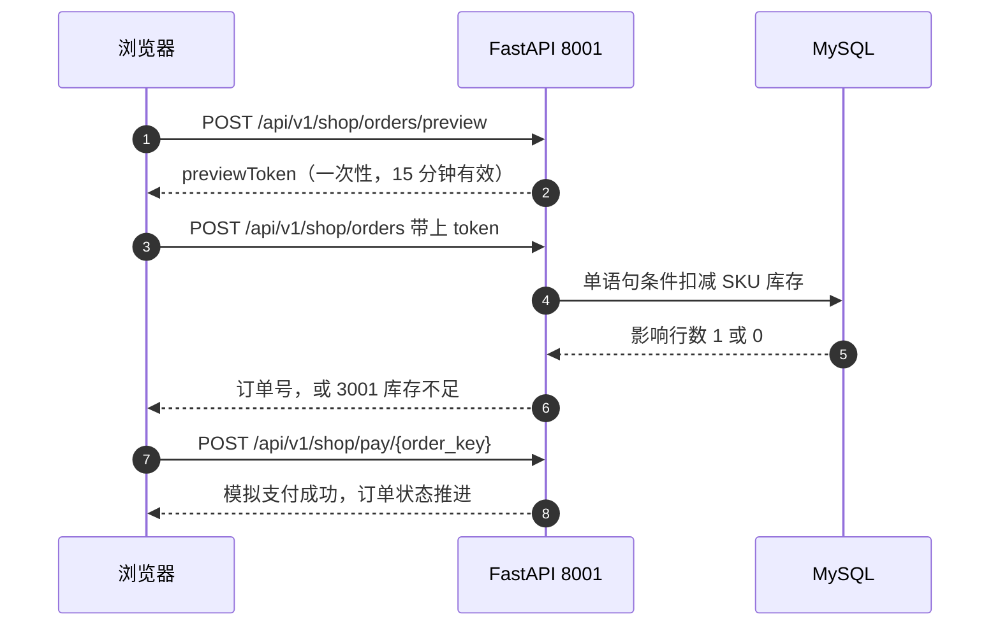
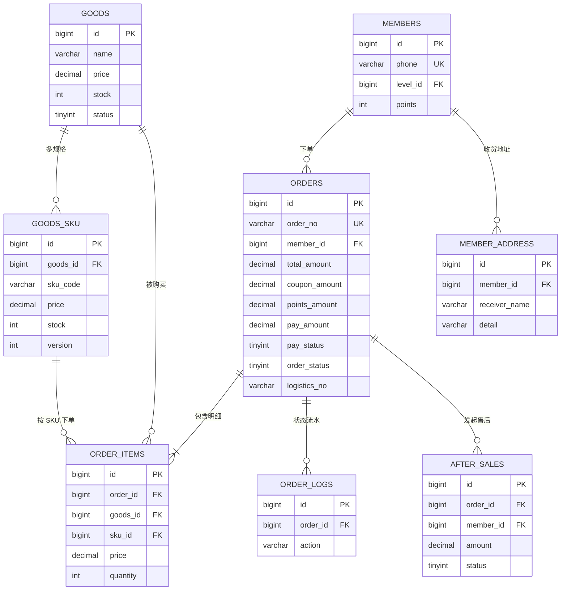
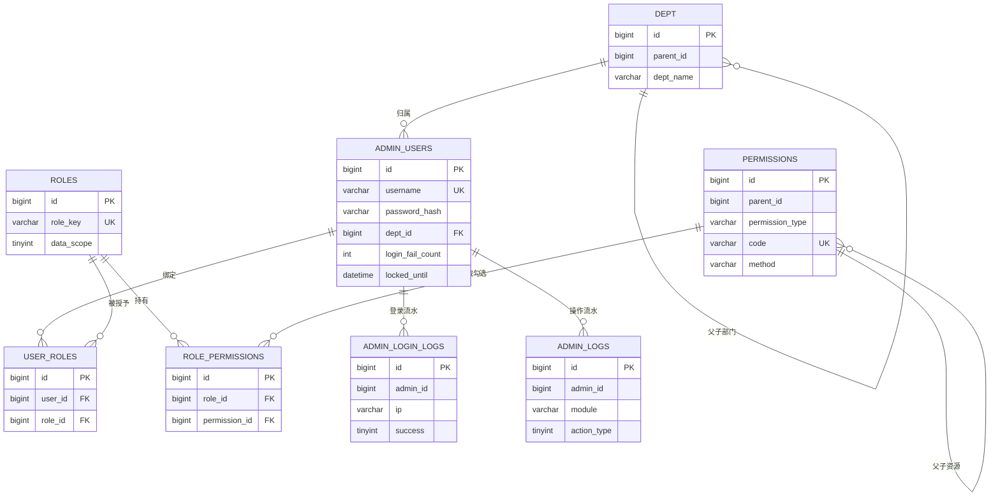
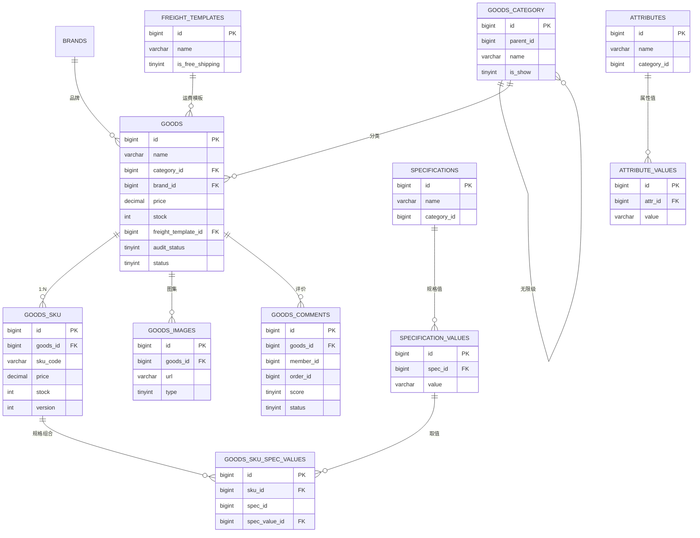
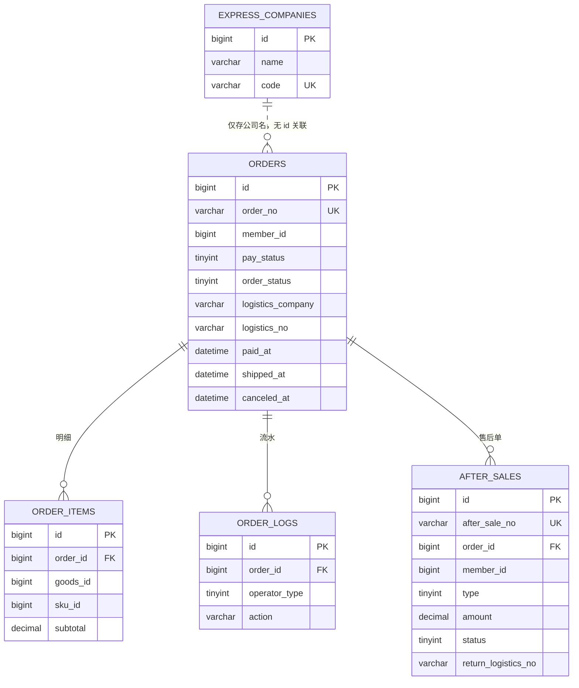
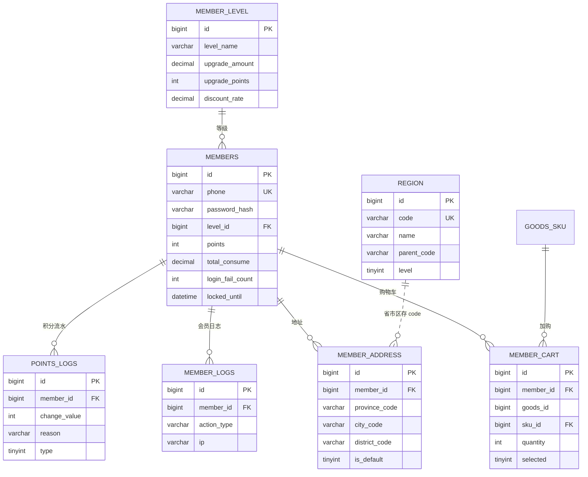
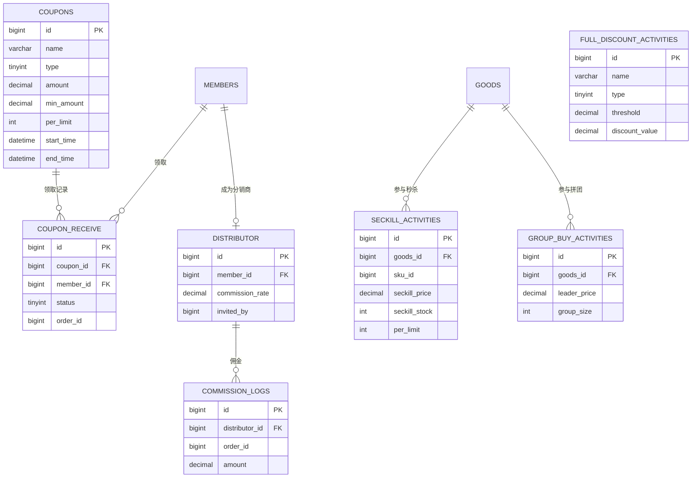
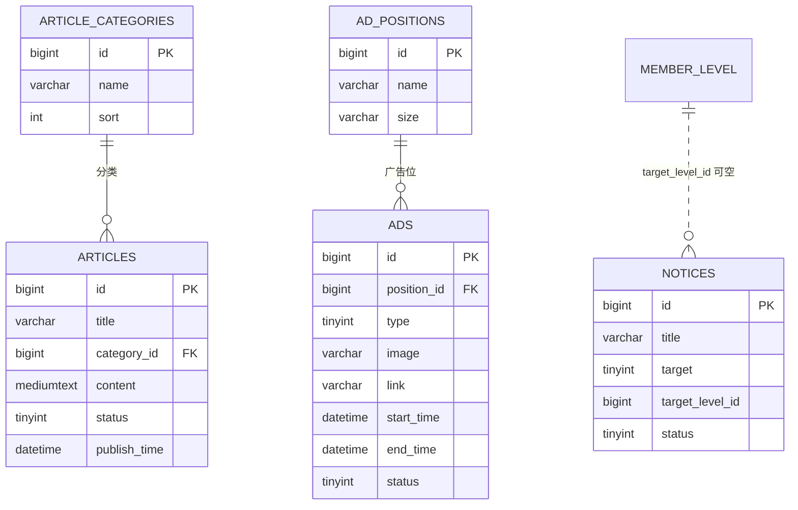
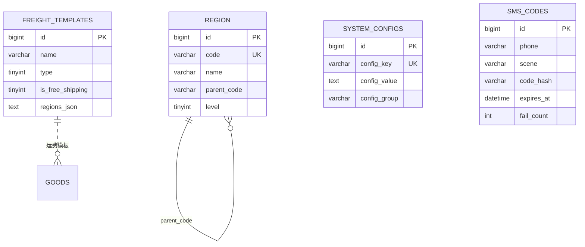

# 接口与配置手册

> 备查性质：跑通项目不需要读本页。
>
> 日常操作看 [操作手册.md](./操作手册.md)，改代码看 [开发指南.md](./开发指南.md)。
> 接口契约以运行后的 <http://127.0.0.1:8001/api/docs> 为准，本页只是速查。

### 环境变量（`backend/.env`）

| 变量 | 默认值 | 说明 |
|---|---|---|
| `APP_NAME` | `suixinshop` | 应用名，由 `/api/v1/health` 的 `app` 字段回显 |
| `DB_HOST` / `DB_PORT` | `127.0.0.1` / `3306` | MySQL 地址 |
| `DB_USER` / `DB_PASSWORD` | `root` / 空 | 账号密码；本地 root 无密码时留空 |
| `DB_NAME` | `suixinshop` | 库名（seed 自动创建） |
| `DB_POOL_MIN` / `DB_POOL_MAX` | `2` / `10` | 连接池大小，不得超过 MySQL `max_connections` |
| `JWT_SECRET` | **必填** | 签名密钥，缺失则启动失败 |
| `MEMBER_JWT_SECRET` | 空（回退 `JWT_SECRET`） | 会员端令牌密钥，建议独立配置 |
| `JWT_EXPIRE_MINUTES` | `120` | 令牌有效期 |
| `SMS_MOCK` | 模板 `true` / 代码默认 `false` | 演示短信通道：验证码随机生成、哈希落库、通过 `devCode` 回显。**开启即等于公开注册后门，仅限本地演示**；对外部署必须 `false`（置 `false` 后未内置服务商 SDK，注册停用） |
| `SMS_CODE_EXPIRE_SECONDS` / `SMS_INTERVAL_SECONDS` | `300` / `60` | 验证码有效期、同号发送间隔 |
| `ADMIN_INIT_PASSWORD` | 空（随机） | 填了则每次 `seed base` 都按该值覆盖 admin 密码；留空且账号已存在时不动 |
| `ORDER_PAY_TIMEOUT_MINUTES` | `14` | 待付款订单超时分钟数 |
| `GOODS_AUDIT_ENABLED` | `false` | 新商品审核开关（`true` 后需审核通过才上架） |
| `CORS_ORIGINS` | 含 8000/8001 的 `127.0.0.1` 与 `localhost` | 跨域白名单，**禁止 `*`** |
| `UPLOAD_DIR` / `UPLOAD_MAX_MB` | `uploads` / `5` | 上传目录与单文件上限 |
| `UPLOAD_PUBLIC_BASE` | 空（按请求 host 推导） | 上传文件对外 URL 前缀，反代 / HTTPS 后需显式设置 |
| `LOGIN_FAIL_LIMIT` / `LOGIN_FAIL_LOCK_MINUTES` | `5` / `15` | 登录失败次数与锁定时长 |
| `PAGE_SIZE` | `20` | 默认分页大小 |
| `PORT` / `RELOAD` | `8001` / `0` | 监听端口；`RELOAD=1` 开热重载 |
| `STATIC_MANAGER_DIR` | 仓库根 `manager/` | 后台静态目录，一般无需配置 |
| `STATIC_FRONT_DIR` | 仓库根 `front/` | 前台静态目录。后端不再挂载 `/front`，但 `/shop/live/version` 会扫描该目录下的 html/css/js 生成指纹（前台自动刷新用），挪动前台目录时需同步修改 |

### 依赖安装（不使用 uv 时）

```bash
cd backend
python -m venv .venv
.venv\Scripts\activate                 # Windows；macOS/Linux 用 source .venv/bin/activate
pip install -r requirements.txt        # 仅运行
pip install -r requirements-dev.txt    # 需要跑 pytest 时
```

推荐仍用 `uv sync`（见 README）：`requirements*.txt` 与 `pyproject.toml` 的版本范围保持一致，供 pip 用户使用。

### 接口清单

统一前缀 `/api/v1`，返回 `{ code, message, data }`。合计 186 个操作 = 后台 133 + 前台 52 + 健康检查 1（`GET /api/v1/health`）。

鉴权分两类：

<span>&nbsp;•&nbsp;&nbsp;&nbsp;</span>**后台接口**：除登录外都需要后台令牌

<span>&nbsp;•&nbsp;&nbsp;&nbsp;</span>**`/shop/*`**：浏览类公开（首页、商品、分类、品牌、规格、区域、版本）；账户 / 购物车 / 订单 / 支付 / 售后 / 优惠券 / 积分需会员令牌

#### 后台接口（133）

| 模块 | 接口数 | 路径 |
|---|---|---|
| auth | 4 | `POST /auth/login`、`POST /auth/logout`、`GET /auth/me`、`PUT /auth/password` |
| permission | 21 | `/permission/admins`、`/permission/roles`（含 `/copy`）、`/permission/tree`、`/permission/resources`、`/permission/depts`、`/permission/login-logs`，均为增删改查 |
| goods | 30 | `/goods`（列表/详情/新增/编辑/删除/批量上下架/批量删除/审核/导出）、`/categories`、`/brands`、`/goods/specs`、`/goods/attrs`、`/goods/comments` |
| order | 12 | `/orders`（列表/导出/详情/改价/发货/批量发货/取消）、`/after-sales`（审核/确认收货）、`/express-companies` |
| member | 11 | `/members`（列表/详情/编辑/启停/重置密码）、`/member-levels`、`/points/logs`、`/points/adjust`、`/member-logs` |
| marketing | 22 | `/coupons`（含 `/records`）、`/seckills`、`/full-discounts`、`/group-buys`、`/distributors`（含 `/commissions`）、`/marketing/*` 选项接口 |
| content | 21 | `/article-categories`、`/articles`、`/ad-positions`、`/ads`、`/notices`、`/content/level-options` |
| settings | 6 | `/settings/{group}`（读/写）、`/freight-templates` |
| dashboard | 3 | `/dashboard/overview`、`/dashboard/trend`、`/dashboard/hot-goods` |
| admin-logs | 2 | `/admin-logs`、`/admin-logs/export` |
| upload | 1 | `POST /upload` |

#### 商城前台接口（52，前缀 `/api/v1/shop`）

| 模块 | 接口数 | 路径 |
|---|---|---|
| 认证 | 7 | `/shop/auth/send-code`、`/register`、`/login`、`/me`、`/password`、`/profile`、`/logout` |
| 首页与商品 | 11 | `/shop/home`、`/notices`、`/ads`、`/goods`、`/goods/{id}`、`/goods/{id}/comments`、`/goods/{id}/visit`、`/categories`、`/brands`、`/specs` |
| 购物车 | 7 | `/shop/cart`（增删改查/清空/勾选/合并） |
| 订单 | 8 | `/shop/orders/preview`、`POST /orders`、`/orders`、`/orders/{key}`、`/cancel`、`/confirm-receipt`、`/again`、`/logistics` |
| 支付 | 2 | `POST /shop/pay/{order_key}`、`GET /shop/pay/{order_key}/status` |
| 地址与区域 | 6 | `/shop/addresses`（含 `/default`）、`/shop/regions` |
| 售后 | 5 | `/shop/after-sales`（列表/详情/发起/填物流/撤销） |
| 优惠券 | 3 | `/shop/coupons`、`/coupons/available`、`/coupons/{id}/receive` |
| 积分 | 2 | `/shop/points`、`/shop/points/logs` |
| 实时更新 | 1 | `/shop/live/version`（内容/资源指纹，前台轮询自动刷新） |

#### 下单链路（开发者视角）



### 数据库（46 张表）

| 分组 | 表 |
|---|---|
| 权限与账号（8） | `admin_users` `dept` `roles` `permissions` `user_roles` `role_permissions` `admin_login_logs` `admin_logs` |
| 商品（11） | `goods_category` `brands` `specifications` `specification_values` `attributes` `attribute_values` `goods` `goods_sku` `goods_sku_spec_values` `goods_images` `goods_comments` |
| 订单与售后（5） | `orders` `order_items` `order_logs` `after_sales` `express_companies` |
| 会员（6） | `members` `member_level` `points_logs` `member_logs` `member_address` `member_cart` |
| 营销（7） | `coupons` `coupon_receive` `seckill_activities` `full_discount_activities` `group_buy_activities` `distributor` `commission_logs` |
| 内容（5） | `articles` `article_categories` `ad_positions` `ads` `notices` |
| 系统（4） | `system_configs` `freight_templates` `region` `sms_codes` |

建表语句在 `backend/seed/schema.py`，全部 `CREATE TABLE IF NOT EXISTS`。

**表间约定**：全部为**逻辑关联**，DDL 里没有任何 `FOREIGN KEY` 约束 —— 一致性由应用层保证。删商品不会级联删 SKU、删订单不会级联删明细，改状态时也没有数据库层兜底。二次开发时这条必须先记住。

### 关系图（ER）

按域拆分，字段只列主键、关联键与业务关键字段；完整字段见 `backend/seed/schema.py`。实线为 id 关联，虚线为「存名字 / 存 code」的弱关联。

#### 主干：一笔订单怎么串起来



下单时 `ORDERS` 会快照收货人三要素（`receiver_name` / `receiver_phone` / `receiver_address` 是冗余字段），地址后续被改被删都不影响历史订单；`ORDER_ITEMS` 同样快照 `goods_name` / `goods_image` / `spec_value` / `price`。

#### 权限与账号（8 张）



`data_scope` 落在 `roles` 上（不是管理员），多角色取最大值；实际生效位置只有商品与管理员账号两处，见 README §7 的权限边界说明。

#### 商品（11 张）



`goods.stock` 与 `goods_sku.stock` 是两份：下单时两者都会扣，SKU 为准、商品级库存用于列表展示与预警。`goods_sku.version` 配合条件更新做乐观锁。

#### 订单与售后（5 张）



**注意**：`orders.logistics_company` 存的是公司**名称字符串**，不是 `express_companies.id`。改快递公司名字不会影响历史订单，但也没法按公司 id 做统计。

#### 会员（6 张）



`member_cart` 有 `UNIQUE(member_id, sku_id)`，同一 SKU 只会有一行，游客购物车登录后合并就靠这个约束。

#### 营销（7 张）



只有 `seckill_activities` 的 `seckill_price` 接进了结算；`seckill_stock` / `per_limit` / 满减 / 拼团 / 佣金都只落库不参与算钱。`coupon_receive` 的 `UNIQUE(coupon_id, member_id)` 使 `per_limit > 1` 无效。

#### 内容（5 张）



`articles` 在后台可维护，但前台 18 页里**没有文章页**，内容只落库不展示。

#### 系统（4 张）



`system_configs` 是 key-value 表，密钥类 key 读取时脱敏（见 `SECURITY.md`）。`freight_templates.regions_json` 存 JSON 文本，没有拆分表。

### seed 命令

在 `backend/` 执行，全部幂等：

| 命令 | 作用 |
|---|---|
| `uv run python -m seed.runner base` | 建表 + 基础数据（管理员/角色/权限、会员等级、快递公司） |
| `uv run python -m seed.runner demo` | 演示数据（商品、会员、订单、营销、内容） |
| `uv run python -m seed.runner clean-base` | 清基础数据（不影响演示数据） |
| `uv run python -m seed.runner clean-demo` | 清演示数据（不影响基础数据） |

不带参数默认 `base`。演示数据按业务键幂等（商品按 id、订单按单号、会员按手机号、流水按「会员+事由」查重），重复执行只补缺失。

演示数据里的日期是固定字面量，入库时按「执行当天 − 数据内最新订单日」的天数**整体平移**，因此任何一天执行 `demo`，订单、广告、秒杀、拼团、文章都落在最近一段时间内，仪表盘与热销榜不会随时间被清空；各条数据之间的相对时序不变。重复执行 `demo` 会刷新演示订单的时间列（不覆盖管理端改过的状态与金额）。会员的 `registered_at` 固定为 `2026-01-01`（用于演示「按注册时间筛选」），不参与平移。

演示图片会自动从 `front/images/` 同步到 `uploads/seed/`，URL 前缀默认 `http://127.0.0.1:8001/uploads/seed/`。

### 自动化测试

```bash
cd backend
uv run pytest -q tests
```

三条前置缺一不可：

1. MySQL 可达，且 `seed base` 与 `seed demo` 都执行过（部分用例断言演示数据规模）
2. `.env` 里 `JWT_SECRET` 已填（缺了连用例都收集不到）
3. `.env` 里 `ADMIN_INIT_PASSWORD` 有值，且与当前 admin 密码一致（不一致时重跑一次 `seed base` 同步）

测试直连 `DB_NAME` 真实库，没有独立测试库与回滚，跑完会留下测试数据；想复原执行 `clean-demo` 再 `demo`。

数据库不可达时 `tests/conftest.py` 会在收集用例前直接退出并打印修复提示（本地退出码 0，`CI` 或 `REQUIRE_DB=1` 下为 1），因此**任何** pytest 命令都需要可用的 MySQL，没有可以离线运行的子集。
